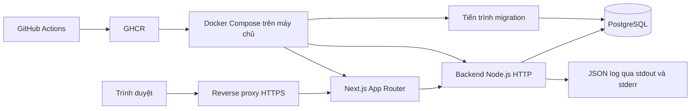

# Kiến trúc Alumni Hub

HTTP đọc cấu hình trước khi mở cổng. `/health` trả trạng thái tiến trình và phiên bản. `/ready` kiểm tra migration tối thiểu qua PostgreSQL và trả HTTP 503 khi chưa sẵn sàng. Reverse proxy chuyển tiếp HTTPS vào cổng loopback của Compose. Ở dev, người dùng có thể gọi HTTP trực tiếp.

Frontend phục vụ website công khai và `/admin`, chuyển tiếp các yêu cầu `/api/*` cùng origin. Backend quyết định quyền theo phiên. Đăng ký và thay đổi sức chứa cùng khóa hàng sự kiện trong transaction. Khóa chính `(event_slug, account_id)` chặn đăng ký trùng.

Migration đọc SQL theo thứ tự tên, dùng transaction và advisory lock để hai lần chạy đồng thời không áp dụng cùng thay đổi hai lần. Bảng `schema_migrations` giữ tên và checksum. Migration đã áp dụng phải giữ nguyên. Thay đổi mới thêm tệp mới.

GitHub Actions phát hành image chứa hai bản build, migration runner và SQL. Hai container ứng dụng dùng cùng digest. Cấu hình cơ sở có một replica mỗi dịch vụ nên thay image có thể làm gián đoạn ngắn.
